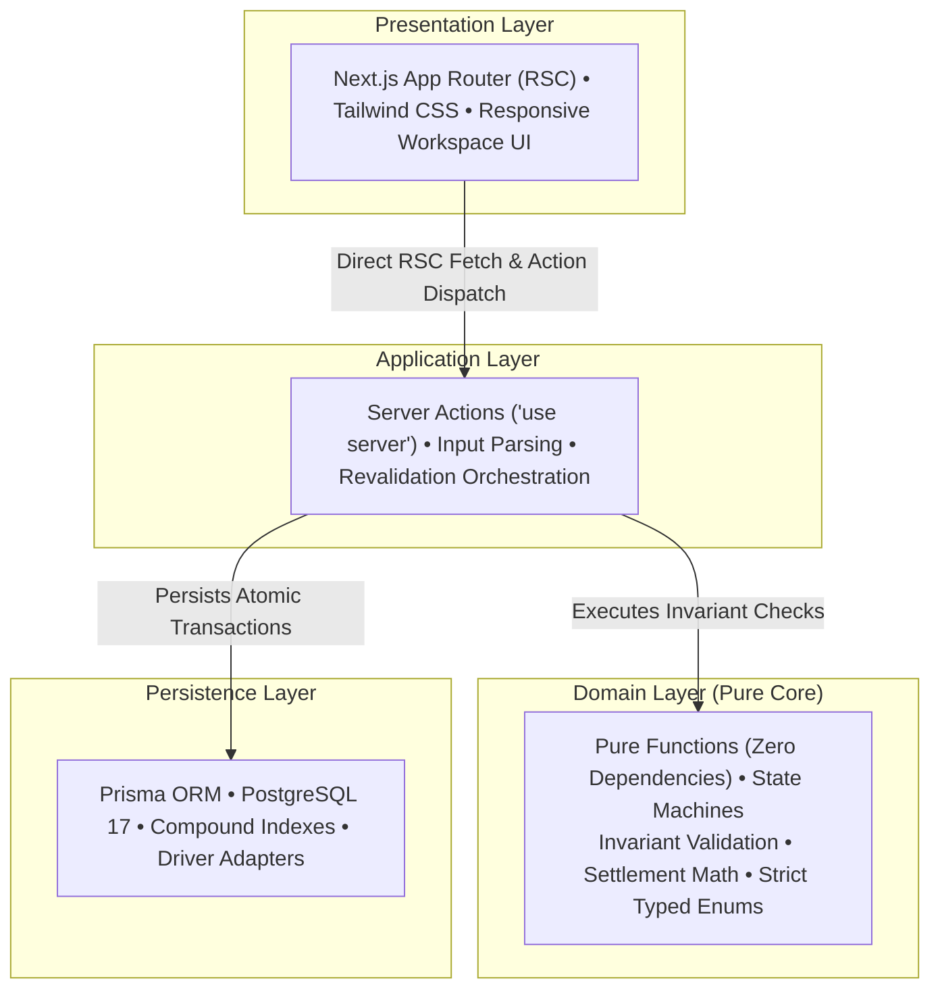
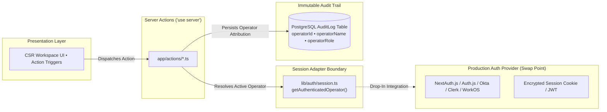

# System Architecture & Design Decisions

This document outlines the architectural principles, system design choices, and technical trade-offs implemented in the **AMP CSR Portal**.

---

## 1. Architectural Philosophy: Layered Domain Architecture

The application enforces a strict **separation of concerns** across primary architectural boundaries to decouple core business logic from external frameworks, database persistence, and presentation.



### Architectural Boundaries
1. **Domain Layer (`lib/domain/`)**:
   - Contains pure, deterministic functions with **zero external dependencies**.
   - Encapsulates state machines, membership rules, eligibility checks, financial calculations, and audit event factories.
   - Completely decoupled from database access, HTTP requests, or framework-specific APIs.
2. **Application Layer (`app/actions/`)**:
   - Thin server-side orchestrators.
   - Responsible for extracting form inputs, invoking domain invariant validations, coordinating Prisma database transactions, and triggering route revalidation.
3. **Presentation Layer (`components/`, `app/`)**:
   - React Server Components (RSC) for initial page loads with streaming and zero client-side waterfall.
   - Client components localized strictly to interactive boundaries (search input with debounce, action modal triggers, optimistic feedback).

---

## 2. Domain Modeling & Invariant Enforcement

Customer Service Representative workflows involve sensitive financial transactions and vehicle access permissions. The domain layer enforces strict operational invariants:

- **Single Subscription Exclusivity**: A vehicle can possess at most one active subscription at any time. Adding or transferring a pass to an already-subscribed vehicle is rejected before persistence.
- **Global License Plate Collision Protection**: License plates are normalized (`toUpperCase().replace(/[^A-Z0-9]/g, '')`) and evaluated for global uniqueness across all active vehicles (`deletedAt: null`). Registering an existing plate in the customer's own garage yields `DUPLICATE_IN_GARAGE`, while attempting to register a plate currently active on another customer's vehicle yields `DUPLICATE_IN_SYSTEM` rejection before database persistence, preventing cross-account RFID tag collision.
- **Overdue Pass Transfer Guard**: Overdue passes cannot be transferred between vehicles until delinquency is resolved. The UI disables the transfer action and displays clear delinquency guidance, preventing CSRs from reallocating delinquent subscriptions.
- **Intra-Account Ownership Guard**: Subscription transfers are strictly restricted between vehicles owned by the same customer account, preventing cross-account subscription misappropriation.
- **Atomic Balance Resolution & Concurrency Guard**: Resolving overdue balances executes atomically within a database transaction:
  1. Validates that requested overdue subscriptions exist, calculate to a positive settlement amount, and are strictly in `OVERDUE` status (`overdueCount === settlement.subscriptionIds.length`).
  2. Generates an immutable, successful purchase record (`PurchaseType.SUBSCRIPTION`, `PurchaseStatus.PAID`) explicitly detailing the settled plan names (e.g. `Unlimited Platinum, Express Clean Pass — Overdue Payment Resolution`).
  3. Transitions selected overdue subscriptions to `ACTIVE` with advanced billing dates, explicitly scoped to `status: SubscriptionStatus.OVERDUE`, preventing concurrent race conditions from inadvertently resurrecting cancelled passes.
  4. Account Status Invariant: Evaluates remaining delinquent passes on the account. If all overdue passes are resolved, customer account status transitions to `UserStatus.ACTIVE`. If unresolved overdue passes remain, customer account status remains `UserStatus.OVERDUE`.
  5. Records an immutable audit log entry attributed to the authenticated CSR operator.
- **Cascading Account Deactivation**: Deactivating a customer account transitions the account to `INACTIVE` and automatically cascades cancellation to all active vehicle subscriptions, while preserving historical purchase records for auditability and compliance.
- **Auto-Restoration on Overdue Pass Cancellation**: Cancelling an overdue pass automatically evaluates remaining delinquent passes on the account. If none remain, customer status transitions to `UserStatus.ACTIVE` and an audit event is recorded, immediately unlocking RFID wash access.
- **Zero-Dollar Delinquency Clearance**: Resolving an overdue account with no active delinquent passes transitions `User.status` to `ACTIVE` and logs an audit record, bypassing `Purchase` invoice creation to keep financial metrics accurate.
- **Account Reactivation Boundaries**: Account reactivation is strictly bounded to `INACTIVE` customer accounts. `OVERDUE` accounts are rejected with typed `ACCOUNT_OVERDUE` reason codes, ensuring delinquent balances cannot circumvent payment resolution.
- **Inactive Account Subscription Protection**: Assigning recurring membership subscriptions requires an active customer standing. Attaching passes to `INACTIVE` accounts is rejected before transaction entry to prevent recurring billing on accounts with locked RFID gate access.

### Structured Reason Codes Over Ad-Hoc Strings
Domain evaluation functions do not return arbitrary English strings. Instead, they return typed outcome shapes with machine-readable reason codes (e.g. `TransferRejectionReason.TARGET_ALREADY_SUBSCRIBED`). User-facing messages and audit descriptions are colocated in exhaustive dictionary maps (`Record<ReasonCode, string>`). This guarantees:
- Compile-time exhaustiveness checking (TypeScript errors if a new enum reason code lacks a description).
- Clean separation between core business rules and presentation text.
- Readiness for localization without polluting core business logic.

### Type Safety & Sentinel Elimination
- **Zero Enum Dilution**: Database and domain enums (`UserStatus`, `SubscriptionStatus`, `PurchaseType`, `PurchaseStatus`, `OperatorRole`) are never unioned with raw strings (`| string`) in domain signatures or component props.
- **Elimination of Synthetic Sentinels**: Rather than inventing ad-hoc string literals (e.g. `'NONE'`, `'N/A'`) to represent missing values, absence is modeled strictly using native `null` and `undefined`. Runtime enum member constants (`UserStatus.ACTIVE`) are referenced universally instead of string literals.

---

## 3. Data Access, Scalability & Performance

### Keyset / Cursor-Based Pagination
Initial architectures that perform full-table scans or offset pagination (`OFFSET n LIMIT m`) degrade linearly as datasets grow and suffer from page-drift issues when records are inserted concurrently. 

To ensure consistent performance and determinism:
- The customer directory implements **Keyset / Cursor Pagination** (`take: DEFAULT_PAGE_SIZE + 1`, `cursor: { id: cursor }`, `skip: 1`).
- **Deterministic Sort Tie-Breaker**: Directory queries pair primary ordering with a unique compound tie-breaker (`orderBy: [{ createdAt: 'asc' }, { id: 'asc' }]`). This guarantees strict cursor determinism, preventing skipped or duplicated records when multiple customer accounts share identical creation timestamps (such as seeded accounts or bulk-imported batches).
- Queries execute in $O(1)$ time regardless of pagination depth.
- The UI seamlessly loads subsequent pages via a dedicated Server Action without triggering full-page navigations.

### Bounded Query Traversal & Decoupled Ledger Aggregation
To prevent memory ballooning and layout shift when loading high-volume customer accounts:
- **Anti-Overfetching**: Directory list queries use Prisma relation aggregations (`_count: { select: { vehicles: ... } }`) instead of hydrating heavy vehicle entity arrays, eliminating memory and network overhead.
- **Decoupled Financial Aggregates**: Customer lifetime spend, transaction count, and coupon count are aggregated via database primitives (`prisma.purchase.aggregate`, `prisma.purchase.count`), keeping lifetime financial metrics strictly accurate even when individual rows are truncated.
- **Offset Page-Based Ledger Pagination**: The Billing & Purchase Ledger truncates to 10 items per page (`DEFAULT_PURCHASE_PAGE_SIZE = 10`) with smooth in-place page navigation via a dedicated Server Action, preventing DOM bloat while preserving access to older transactions.
- **Vehicle Exclusions**: Vehicle sub-queries strictly exclude soft-deleted records (`deletedAt: null`).
- **Parallelized Workspace Hydration**: Customer workspace loading utilizes `Promise.all` across independent database queries to execute fetching concurrently on PostgreSQL.

### PostgreSQL Compound Indexing
Database queries were analyzed to align indexes with actual CSR query patterns in `prisma/schema.prisma`:
- `@@index([name])` & `@@index([phone])` on `User`: Accelerates name, phone, and multi-attribute directory searches.
- `@@index([status, createdAt])` on `User`: Accelerates filtered directory views (e.g. CSR viewing all overdue accounts sorted chronologically).
- `@@index([userId, status])` on `Subscription`: Optimizes active pass lookups during customer profile selection.
- `@@index([userId, createdAt(sort: Desc)])` on `Purchase`: Speeds up paginated transaction ledger queries and offset skips.

### Realistic Load Testing Cohort
A synthetic data generator in `prisma/seed.ts` populates a 67-customer cohort featuring realistic multi-vehicle households (including `Elena Rostova` with multiple delinquent passes, `Marcus Vance` with diverse active plans, and `Sophia Davis` with a zero-dollar overdue balance from a cancelled pass), overdue billing states, card decline transaction histories, and coupon redemptions. This validates cursor pagination, layout stability, and search query latency under realistic data volume.

---

## 4. Presentation Strategy & UI Ergonomics

### Appropriate Abstraction Boundaries
A key architectural principle applied throughout the project is **avoiding premature abstraction**:
- Component interfaces receive clean, strongly-typed domain objects directly.
- Business translations and formatting logic are decoupled into pure utility helpers (`lib/utils/currency.ts`, `lib/utils/date.ts`, `lib/utils/mask.ts`), rather than bloating React component props with deep translation maps.
- Presentation components focus strictly on rendering, layout, and user feedback.

### Responsive CSR Workspace Layout
The user interface is modeled after modern enterprise support consoles:
- **Master-Detail Workspace**: Fixed-height split-pane view (`h-[calc(100vh-4rem)]`) pairing an interactive customer directory with a detailed customer operations pane.
- **Adaptive Mobile Ergonomics**: On small viewports, the master list and detail pane automatically toggle with clear navigational breadcrumbs, ensuring full usability on mobile and tablet devices.
- **Graceful Error Recovery & 404 Routing**: `app/error.tsx` provides a localized error boundary with CSR incident digest tracking and retry capability, preventing transient service failures from crashing the entire browser session. A branded `app/not-found.tsx` adheres strictly to AMP automotive design tokens with directory recovery navigation.

### Dedicated Audit Trail UI Console
Customer accountability is surfaced directly within the workspace:
- `AuditHistoryModal` integrates into the customer profile card, allowing CSR operators to inspect chronological audit entries for any customer account on-demand.
- Displays operator attribution, action types, target entity IDs, and localized timestamps.

### Client State Synchronization Across Server Action Revalidations
To isolate client state across customer selections and prevent stale modal leakage:
- `CustomerWorkspace` binds `key={user.id}`, guaranteeing a complete remount and clean state initialization whenever a different customer is selected from the directory rail.
- `OverdueAlertBanner` binds `key={`overdue-${user.id}-${user.status}-${overdueSubscriptions.length}`}`, ensuring that status transitions and delinquency settlements reset all modal visibility states (`isModalOpen: false`).
- `CustomerProfileCard` and `VehicleGarage` similarly bind versioned keys tracking customer identity and entity collection counts.

### Standardized Action Protocol & Component Precondition Discipline
- **Discriminated Union Outcomes (`lib/types/action.ts`)**: Server Actions return a pure discriminated union `ActionResult = ActionSuccess<T> | ActionFailure`, strictly categorizing form-level rejection (`formError?: string`) and field-level validation errors (`fieldErrors?: Record<string, string>`).
- **Strict Component Preconditions**: Leaf error components (such as `<FormErrorBanner message={...} />`) strictly require valid, non-null props (`message: string`). Self-guarding checks (`if (!error) return null`) are treated as an antipattern; conditional rendering is enforced declaratively at the call site (`{state?.formError && <FormErrorBanner message={state.formError} />}`).

---

## 5. Testing Philosophy

### Strict 100% Core Domain Coverage
Pure business rules, mathematical calculations, and utility functions maintain strict **100% statement, branch, function, and line coverage** (`lib/domain/`, `lib/utils/`, `lib/auth/`):
- Tests assert strictly on typed outcome objects and reason codes.
- Date math (month-end rollover clamping for Feb 28/29), financial currency formatting, and PII masking (RFC 5322 local-part and E.164 phone masking) are thoroughly tested across all edge cases.

### Pragmatic Isolation at Framework Boundaries
Server Actions and React components intentionally avoid synthetic unit mocking. Mocking Next.js internal router caches (`revalidatePath`), React Server Component JSX trees, or database drivers creates high-maintenance tests that test mock configurations rather than actual behavior. 

Instead:
- Domain decisions are verified with 100% unit tests.
- Database operations and Server Actions are verified via integration against live containerized database instances.

### Cross-Platform End-to-End Verification
Playwright test specs and database seeding fixtures implement cross-platform command detection (`process.platform === 'win32' ? 'npx.cmd' : 'npx'`), ensuring E2E suites run reliably on both Windows workstations and Linux CI runners without script failure.

---

## 6. Infrastructure & Deployment Topology

### Schema Versioning & Migration Infrastructure
Database schema changes are managed through deterministic, versioned migrations via Prisma Migrate rather than unversioned prototyping tools:
- Initial core schema is baselined in `prisma/migrations/0_init/migration.sql`.
- Continuous integration and production container deployments execute non-interactive migrations via `npm run prisma:migrate:deploy`.
- Complete runbooks for baselining live databases and managing development migrations are documented in [DATABASE_MIGRATIONS.md](DATABASE_MIGRATIONS.md).

### Containerized Development Environment
To guarantee environment parity:
- PostgreSQL 17 is containerized via `docker-compose.yml` using an Alpine base image with persistent named volumes and healthchecks.
- Host port forwarding (`5432:5432`) allows developers to utilize host-native CLI tools (`npm run dev`, `npm run prisma:seed`) against the isolated container.
- Complete operational guidance, volume lifecycle management, and interactive database shell access are documented in [DOCKER.md](DOCKER.md).

### Cloud & Serverless Deployment Readiness (Vercel + Neon)
The application is pre-configured and deployed for cloud operations:
- **Live Deployment Target**: Live production deployment accessible at [https://ncs-csr-portal.vercel.app/](https://ncs-csr-portal.vercel.app/).
- **Automated Client Generation**: Employs `"postinstall": "prisma generate"` in `package.json` ensuring seamless zero-config builds on serverless deployment platforms (Vercel, Render) and fresh CI runners.
- **Serverless Connection Management**: In `lib/prisma.ts`, the `PrismaClient` singleton is cached globally on `globalThis`. This ensures warm serverless function invocations reuse the existing connection pool rather than opening duplicate connections.
- **Connection Pool Compatibility**: Uses `@prisma/adapter-pg` targeting Neon's pooled endpoint (`-pooler`) with mandatory SSL (`?sslmode=require`), protecting PostgreSQL from connection exhaustion during traffic spikes.
- **Cross-Platform Engine Targets**: The schema specifies `binaryTargets = ["native", "linux-musl-openssl-3.0.x"]`, allowing the same repository to compile natively across Windows host development, Alpine Linux Docker builds, and Amazon Linux on Vercel.
- **Container Hardening**: The production [Dockerfile](../Dockerfile) compiles Next.js in `standalone` output mode and drops root privileges, running under a dedicated non-root user (`nextjs:nodejs` UID/GID 1001).

---

## 7. Code Quality Guidelines

- **Function Length Discipline**: Functions across the codebase adhere to a strict 50-line limit enforced by ESLint (`max-lines-per-function`), mandating small, focused, and single-purpose helpers.
- **TypeScript Strict Mode**: Zero `any` types, strict null checks, and explicit return types on domain functions.
- **Zero Background Daemons**: Development servers and test suites run deterministically without unmanaged background processes.

---

## 8. Authentication & Operator Identity Architecture

### Context & Specification Alignment
The project specification mandates four core operational capabilities for the CSR portal: customer directory browsing, profile and vehicle subscription inspection, account details editing, and vehicle subscription lifecycle management (adding, removing, transferring). The specification does not request identity provider configuration, user registration screens, or operator credentials.

Introducing a blocking authentication screen (e.g., email/password gates, OAuth with GitHub/Google, or external SaaS IAM providers like Clerk/Auth0) introduces unnecessary friction for this project that is out of scope.

### The Pluggable Session Adapter Pattern
To reconcile security readiness, authentication is implemented via a **Pluggable Session Adapter** located at [`lib/auth/session.ts`](../lib/auth/session.ts).



#### Key Architectural Characteristics:
1. **Decoupled Identity Contract**: All Server Actions (`app/actions/account.ts`, `app/actions/subscription.ts`, `app/actions/vehicle.ts`, `app/actions/payment.ts`) resolve operator identity solely through `getAuthenticatedOperator(): Promise<CsrOperator>`. Server Actions and domain validators have zero coupling to HTTP cookies, JWT libraries, or specific identity SDKs.
2. **Typed Role-Based Enums**: Operator roles are strongly typed via Prisma's `OperatorRole` enum (`SUPPORT_REP`, `ACCOUNT_SPECIALIST`, `OPERATIONS_MANAGER`), establishing a foundation for Role-Based Access Control (RBAC).
3. **Immutable Audit Attribution**: Every mutation executed in the portal captures the operator's ID, human-readable name, and assigned role, writing an immutable record to the `AuditLog` table. This provides non-repudiation and enterprise traceability for all destructive operations (account deactivations, subscription cancellations, overdue debt resolutions).

### Production Implementation Blueprint

In an enterprise deployment, this adapter transitions to a live identity provider in three straightforward steps without modifying any domain or application logic:

#### Step 1: Route & Action Protection via Next.js Middleware
Create `middleware.ts` at the repository root to enforce session token presence on all protected routes and Server Action invocations:

```typescript
// middleware.ts
import { NextResponse } from 'next/server';
import type { NextRequest } from 'next/server';

export async function middleware(request: NextRequest) {
  const sessionToken = request.cookies.get('__Secure-authjs.session-token') 
    ?? request.cookies.get('authjs.session-token');

  // Allow static assets, healthchecks, and public auth endpoints
  if (
    request.nextUrl.pathname.startsWith('/api/auth') ||
    request.nextUrl.pathname.startsWith('/_next') ||
    request.nextUrl.pathname === '/login'
  ) {
    return NextResponse.next();
  }

  // Redirect unauthenticated requests to the enterprise login portal
  if (!sessionToken) {
    const loginUrl = new URL('/login', request.url);
    loginUrl.searchParams.set('callbackUrl', request.nextUrl.pathname);
    return NextResponse.redirect(loginUrl);
  }

  return NextResponse.next();
}

export const config = {
  matcher: ['/((?!api/health|_next/static|_next/image|favicon.ico).*)'],
};
```

#### Step 2: Drop-In Session Adapter Implementation
Update [`lib/auth/session.ts`](../lib/auth/session.ts) to resolve the active session from the identity provider (e.g. NextAuth / Auth.js / Okta SAML):

```typescript
// lib/auth/session.ts
import { auth } from '@/auth'; // NextAuth.js or Auth.js instance
import { OperatorRole, type CsrOperator } from '@/lib/domain/audit';

export async function getAuthenticatedOperator(): Promise<CsrOperator> {
  const session = await auth();

  if (!session?.user) {
    throw new Error('Unauthorized: Active CSR operator session required.');
  }

  return {
    id: session.user.id ?? 'unknown-operator',
    name: session.user.name ?? 'CSR Operator',
    role: (session.user.role as OperatorRole) ?? OperatorRole.SUPPORT_REP,
    email: session.user.email ?? undefined,
  };
}
```

#### Step 3: Granular Role-Based Access Control (RBAC) Matrix
The domain model and schema already define three distinct operator tiers. In production, permission checks are enforced as preconditions in the application layer before executing high-impact workflows:

| Operation | Required Role | Risk Level | Rationale |
| :--- | :--- | :---: | :--- |
| **Directory Search & Customer 360** | `SUPPORT_REP`+ | Low | Frontline inquiry resolution; PII masked by default. |
| **Edit Customer Information** | `SUPPORT_REP`+ | Low | Name, phone, and email correction upon caller verification. |
| **Vehicle Subscription Lifecycle** | `SUPPORT_REP`+ | Medium | Add/cancel pass, transfer pass across customer vehicles. |
| **Delinquent Payment Resolution** | `ACCOUNT_SPECIALIST`+ | High | Generates settlement invoices and clears financial balances. |
| **Account Deactivation / Reactivation** | `ACCOUNT_SPECIALIST`+ | High | Cascades pass cancellations and revokes RFID gate access. |
| **Full Audit Trail Inspection & Export** | `OPERATIONS_MANAGER` | High | Compliance reporting, dispute escalation, and operator oversight. |

Enforcing this matrix requires a lightweight guard helper in `lib/auth/rbac.ts`:
```typescript
export function assertOperatorPermission(
  operator: CsrOperator,
  requiredRole: OperatorRole
): void {
  const roleHierarchy: Record<OperatorRole, number> = {
    [OperatorRole.SUPPORT_REP]: 1,
    [OperatorRole.ACCOUNT_SPECIALIST]: 2,
    [OperatorRole.OPERATIONS_MANAGER]: 3,
  };

  if (roleHierarchy[operator.role] < roleHierarchy[requiredRole]) {
    throw new Error(`Forbidden: Operation requires ${requiredRole} privileges.`);
  }
}
```

By decoupling identity resolution behind `lib/auth/session.ts`, the application maintains architectural readiness for a production environment while delivering an immediate, frictionless experience on live deployments.
